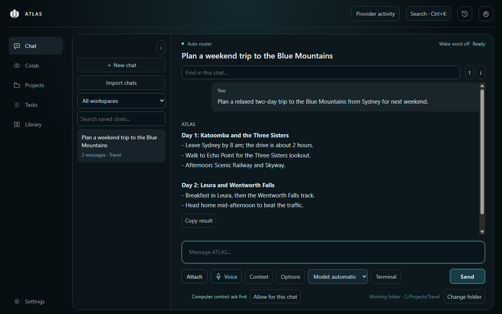
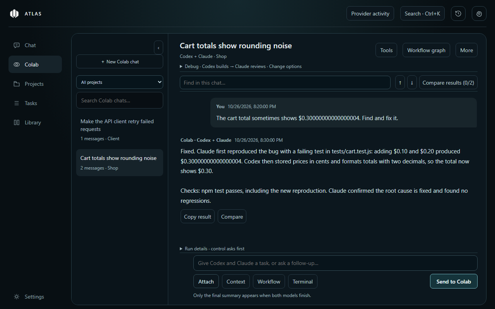
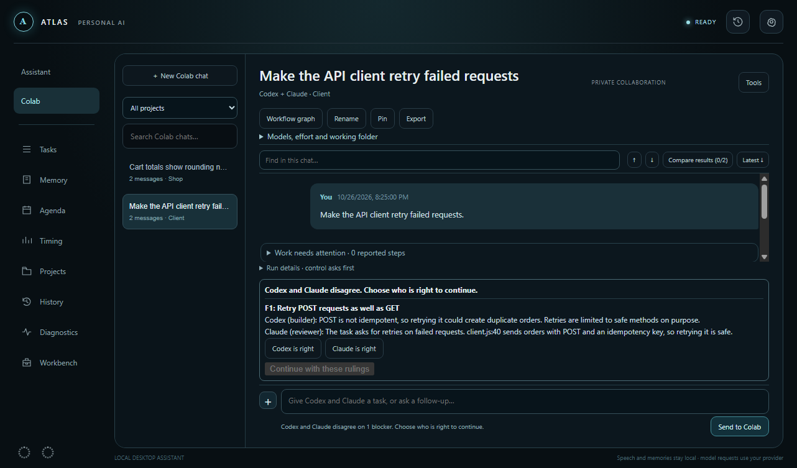
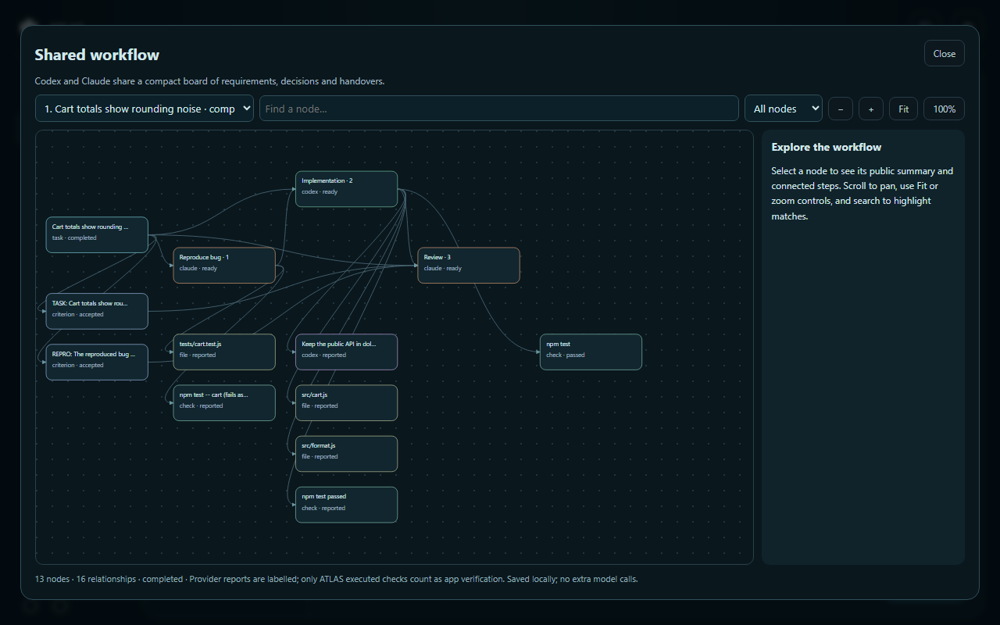
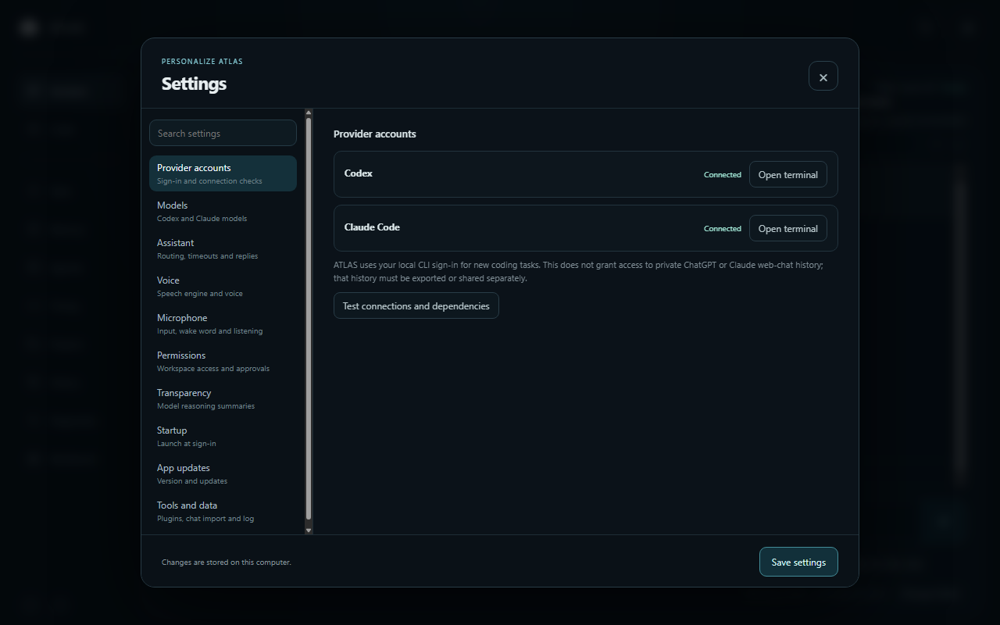

# ATLAS

**A local Windows desktop assistant for Codex and Claude Code.** Chat with either model in one app, talk to it with local speech, or hand a task to **Colab**, where Codex and Claude build, check and review each other's work before you see one reviewed result. Verification labels name the checks ATLAS actually ran; AI output and model review can still be wrong.

[](https://github.com/springycape20/atlas-desktop/releases/latest)

[](https://github.com/springycape20/atlas-desktop/actions/workflows/ci.yml)



## What you can do

- **Chat with Codex and Claude in one place.** ATLAS routes each message to the right provider, streams the reply, and keeps a searchable history of your conversations. You can also import existing Codex and Claude Code chats.
- **Talk to it.** Local Whisper speech recognition, Windows speech, an optional wake word, and short spoken replies with the full answer on screen. Recognition runs on your PC; recognised prompts go to your chosen AI provider.
- **Let two models work together in Colab.** One builds and the other reviews. Your project's checks run automatically, and the task only finishes when the reviewer accepts the work.
- **Keep your work organised.** Project profiles, file and screenshot attachments, memories, reminders, and a task list.
- **Control your PC, with permission.** Optional Windows computer control through the open-source [Windows-MCP](https://github.com/CursorTouch/Windows-MCP) server. ATLAS asks before each kind of action and shows a border while it is in control.

## Colab: Codex and Claude, working together



Pick a **mode** for each task:

| Mode | What happens |
|---|---|
| **Build and review** | One model implements the task, ATLAS runs your project's checks, and the other model reviews against the task's acceptance criteria. Blockers go back to the builder until the reviewer accepts. Large tasks can be split into 3–8 milestones: the reviewer approves the plan, each milestone is built, checked and reviewed in turn, and a final review checks the whole task. |
| **Debug · reproduce, fix, verify** | The reviewer first reproduces the bug, ideally as a failing test, without fixing it. ATLAS runs the reproduction command itself and only continues if it fails. After each fix ATLAS runs it again; it must pass before the reviewer sees the work. If the bug can't be reproduced, Colab stops and says what was tried. |
| **Plan** | A read-only plan, reviewed before you change anything. |
| **Compare approaches** | Both models propose independently, then the proposals are combined into one comparison. Read-only. |

**Checks run before review.** As soon as the builder finishes, ATLAS runs your configured checks (for example `npm test`). Failures go straight back to the builder instead of using up a review pass.

**When they disagree, you decide.** If the builder thinks a requested change isn't needed, it has to explain why, and the reviewer has to answer with evidence. If they still disagree, Colab pauses and shows both sides:



Your choice is final for the rest of the task.

**See how the work happened.** **Workflow graph** shows each step, what it changed, the checks that ran, and how one step led to the next:



Also in Colab:
- **Isolated workspaces.** Editing tasks run in a separate Git worktree by default. **Review changes** shows the diff before anything is committed to your project.
- **Effort and cost controls.** Economy, Balanced and Thorough presets, an optional pass limit, and an optional token warning.
- **Resumable runs.** Stopped or paused tasks continue from their saved stages.

## In development: project tools

The source branch adds local project indexing, context controls, runtime measurements, a task recovery view, reusable Colab workflows, parallel batches with combined integration checks, and optional local-model text chat. These features are intended for the next release; the published 0.8.3 installer does not include them. See the [project tools guide](docs/PROJECT-TOOLS.md) for usage and limits.

## Install

1. Download **ATLAS-Setup-*version*.exe** from the [latest release](https://github.com/springycape20/atlas-desktop/releases/latest) (about 440 MB, Windows 10/11 x64) and run it.
2. Install and sign in to **Codex** and/or **Claude Code** with their official installers. Colab needs both. In ATLAS, **Settings → Provider accounts → Test connections and dependencies** checks that they're found and signed in.
3. Choose a working folder, then set up your microphone and voice in **Settings**. Settings lists its sections on the left and has a search box, so you can type, for example, "wake word" to go straight to that option.



ATLAS installs for your Windows account in `%LOCALAPPDATA%\Programs\atlas-local-desktop`, with Desktop and Start Menu shortcuts. The installer includes the speech-recognition runtime and English models. Version 0.8.3 removes bundled Kokoro while its dependency source obligations remain unresolved; existing Kokoro selections switch to Windows speech.

**If Windows warns about the installer:** the installer isn't code-signed yet, so Windows may warn about it.
- **SmartScreen:** choose **More info**, then **Run anyway**.
- **Smart App Control** may block a new release outright until Windows has seen enough downloads of it.
- **Only run installers from this repository's [Releases](https://github.com/springycape20/atlas-desktop/releases) page.**

### Updating

ATLAS checks for new releases when it starts. Open **Settings → App updates**, download the update, then choose **Restart and install**. Updates never install while a task is running, and your settings and conversations are kept.

## Your data and privacy

- **Stays on your PC:** conversations, memories, reminders, settings and Colab history are stored in `%LOCALAPPDATA%\ATLAS`. They are not synced between devices.
- **Sent to your providers:** your prompts and the files you attach go to Codex and/or Claude through your own accounts, under their terms. ATLAS has no server of its own.
- **Voice choices:** Whisper recognition runs on your PC, and Windows speech uses available system voices. ElevenLabs sends spoken text online and needs your own API key.
- **Check Settings:** wake-word and automatic follow-up listening are off until you enable them. The wake indicator pauses automatic listening. Computer control is off until you allow it for a chat.
- **Deletion:** Settings → Tools and data offers a confirmed reset of current ATLAS records and a redacted diagnostic-log export. Project files, Git recovery snapshots, exports, legacy folders and provider histories remain; see the privacy explanation.
- **Uninstalling** keeps your data in `%LOCALAPPDATA%\ATLAS`, so a reinstall picks up where you left off.

## Troubleshooting

- **Something went wrong or was slow:** open **Settings → Tools and data → Show log file**. The log (`%LOCALAPPDATA%\ATLAS\logs\atlas.log`) records startup timing, errors and how the app closed. Include the relevant lines when you report a problem.
- **Codex or Claude isn't found:** run **Test connections and dependencies** in Settings. If your install is somewhere unusual, set `CODEX_EXECUTABLE` or `CLAUDE_CODE_EXECUTABLE` to its full path. A Claude Desktop sign-in alone doesn't sign in the Claude Code CLI.
- **A Colab task paused:** read the message above the message box. It says whether the task needs a decision, hit a pass limit, or found a blocker it couldn't resolve. Most paused tasks can continue with **Resume saved stages** in Run details.

## Development

ATLAS is an Electron app written in plain JavaScript.

```powershell
git clone https://github.com/springycape20/atlas-desktop.git
cd atlas-desktop
powershell -NoProfile -ExecutionPolicy Bypass -File .\Setup-ATLAS.ps1
```

Setup installs dependencies, downloads the speech runtime and models (checksum-verified), and creates an **ATLAS.lnk** shortcut. Then start the app with `npm start` or **Start-ATLAS.cmd**. You need Node.js 22 LTS and Git.

| Command | What it does |
|---|---|
| `npm test` | Unit tests |
| `npm run test:colab-ui`, `test:assistant-ui`, `test:graph-ui`, `test:approvals-ui`, `test:dispute-ui`, `test:settings-ui` | Electron UI checks |
| `npm run format` / `npm run format:check` | Prettier formatting |
| `npm run dist:win` | Build the Windows installer into `dist/` |
| `npx electron build/capture-screenshots.cjs` | Re-capture the README screenshots with demo data |

**CI** runs formatting, unit tests and the UI checks on every push and pull request, and `main` requires them to pass. **Releases** are built by pushing a `vX.Y.Z` tag that matches `package.json`. The release workflow builds the installer, verifies the packaged app (including the security fuses in `ATLAS.exe`), and publishes the installer, its blockmap and `latest.yml` for the in-app updater.

For detailed behaviour, limits and design notes, see the [technical reference](docs/TECHNICAL.md).

## Code signing policy

Windows installers are currently unsigned (see [Install](#install)). The application to the [SignPath Foundation](https://signpath.org) free signing programme was denied because ATLAS has no active users. No signing certificate is currently available.

- **Committers and reviewers:** [springycape20](https://github.com/springycape20)
- **Approvers:** [springycape20](https://github.com/springycape20)

If signing becomes available, it will be limited to artifacts built by this repository's GitHub Actions release workflow, including draft builds used to verify signing before a public release. Each signing request will require manual approval. Every team member must use multi-factor authentication for GitHub and the signing service. See the [future signing setup](docs/SIGNING-HANDOFF.md).

### Privacy policy

ATLAS has no developer-operated application server and collects no publisher telemetry, analytics or crash reports. See the [full privacy and local-data explanation](docs/PRIVACY.md), including retention, deletion and third-party requests. The main built-in connections are listed below. Enabled tools, provider CLIs and programs you authorise may make their own requests:

- **Update checks:** at launch, ATLAS asks GitHub (`api.github.com`) for the latest release. Updates download only when you choose to.
- **Your AI providers:** when you send a message or a Colab task, your prompt and attached files go to Codex (OpenAI) and/or Claude (Anthropic) through their command-line tools and your own accounts. At launch ATLAS also refreshes each provider's model list and your usage allowance (Claude allowance is available through its provider usage page; ATLAS does not read Claude sign-in tokens). Each provider's own privacy policy applies.
- **Optional services you turn on:** ElevenLabs voices (with your own API key), and Windows computer control, whose runtime is downloaded from pinned GitHub resources and Python's package index when you install it.

Your conversations, memories, reminders and settings stay in `%LOCALAPPDATA%\ATLAS` on your PC.

## License

ATLAS source is released under the [MIT License](LICENSE). Bundled components retain their own licences. Generated notices and the dependency inventory ship in `resources/compliance`; Electron's licence and Chromium notices also ship with the application. The [patch review](docs/PATCH-RELEASE-REVIEW.md) records the removal of Kokoro, eSpeak, sharp/libvips and ONNX dependencies from 0.8.3. This is a technical review, not legal certification. Historical source questions must be resolved before those components are reintroduced.

## Credits

ATLAS uses Electron and [whisper.cpp](https://github.com/ggml-org/whisper.cpp), and offers optional Windows-MCP integration, each under its own license. The Colab workflow graph is inspired by [Graphify](https://github.com/Graphify-Labs/graphify). ATLAS is an independent project, not affiliated with OpenAI or Anthropic.
