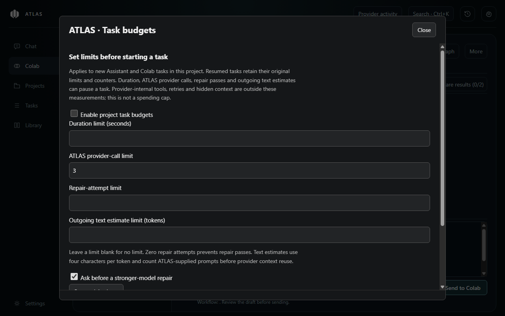
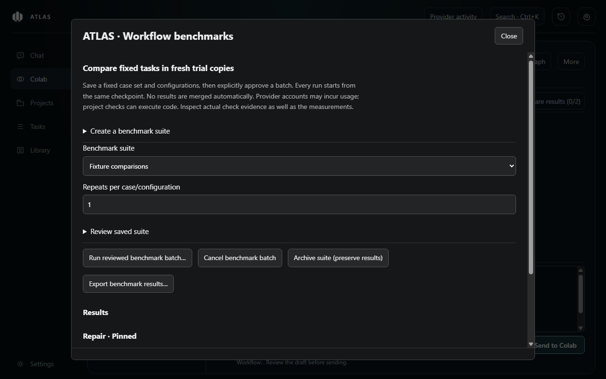

# Task budgets, trial promotion and benchmarks (0.11.0)

These tools are included in ATLAS 0.11.0, available under **Tasks** or through **Ctrl+K**.



## Task budgets

Open **Tasks → Work → Task budgets** for the current project. Enable limits, enter the desired values and save before starting a task. Opening or saving the panel makes no provider request. Blank fields mean unlimited; zero repair attempts prevents repair passes.

| Limit | Enforcement |
| --- | --- |
| Duration | Pauses the job and interrupts its current work when elapsed task time is exhausted. Time includes preparation, approval waits and checks. Resume retains previously used time. |
| ATLAS provider calls | Checked before each ATLAS invocation, including fallback and stronger-model attempts. Failed invocations count; cancelled sensitive-context approval does not. |
| Repair attempts | Counts Colab fix passes, explicit repair-loop invocations and Assistant stronger-model repairs. Initial implementation is not a repair pass. |
| Outgoing text estimate | Cumulative prompt length divided by four, rounded up per invocation, before reference reuse. Enforced before sending. |

Budgets default off. Enabled budgets can also ask before an Assistant stronger-model repair. Existing task/check permission prompts still apply. Each new task snapshots the project's policy; resumed tasks retain their original limits and counters. If a cap is exhausted, review the saved work and start a new scoped task with revised limits rather than repeatedly resuming the exhausted task.

The recorded-budget view distinguishes rough outgoing text from reported input/output tokens. Missing or partial usage stays labelled. Provider tools, internal retries, hidden context, output generation and provider-side cancellation latency are outside these limits. **This is not a monetary or subscription spending cap.** Counters describe ATLAS invocations, not every internal model request. Budgets do not roll back changes already made.

Settings are stored locally in `task-budgets.json` for up to 100 project roots. Limits and counters also enter ordinary saved task records.

## Guided trial promotion

Capture a checkpoint and fork a trial in **Trial checkpoints**. After working in the trial, open **Tasks → Project → Trial promotion**, choose the trial and preview its changes. ATLAS compares the checkpoint, current trial and current original project. Files changed independently in the original are marked as conflicts unless they already match the trial.

Expand patches, select the eligible files and choose **Apply selected promotion…**. Selection starts empty. A native dialog identifies the destination and exact paths before any writes. Additions, modifications and deletions are supported for valid UTF-8 text without a byte-order mark, up to 256 KiB per file, 100 changed files and 2 MiB of before/after text per preview. Binary/private/denied files and symbolic links are excluded or blocked. Conflict resolution remains manual; there is no hunk-level promotion or Git merge.

ATLAS checks source and trial hashes again after approval and before writing. A durable undo record is saved first. **Undo promotion…** restores only files still matching the promoted version, preserving newer edits. A failure can leave a partially applied set; the result names applied files and stops remaining writes. Keep the undo record until you have reviewed the project. Already restored files are skipped during a repeated undo. Empty directories created for additions can remain after undo. Git history is unchanged.

Previews expire after ten minutes or app restart. Up to 20 undo records remain in `trial-promotions.json`, including original text and project paths. Forgetting a record preserves project files and removes that recovery option. Restoring a backup of records does not restore the corresponding external project files; hash checks still govern undo.

## Reproducible workflow benchmarks



Open **Tasks → Review → Workflow benchmarks**. Create a suite from a retained trial checkpoint, fixed task cases, acceptance criteria, check commands and named configurations. The initial editor uses JSON for cases and configurations; saving is passive. Pin explicit model IDs available to your accounts. Colab configurations require both `codexModel` and `claudeModel` and can select `build`, `debug`, `plan` or `compare`.

```json
[
  {
    "name": "Your configuration",
    "provider": "codex",
    "model": "your-installed-provider-model-id",
    "effort": "medium",
    "seconds": 600,
    "providerCalls": 8,
    "repairAttempts": 2,
    "estimatedTokens": 64000
  }
]
```

Those limits are the defaults for each benchmark run. Review the saved definition, select 1–5 repeats and explicitly approve the batch. The dialog shows the number of tasks, per-configuration limits and project check commands. **Real runs use your provider accounts and can incur usage.** Check commands execute project code with your account permissions. ATLAS installs no dependencies. Colab trials initialise a local Git repository.

Every case/configuration/repeat receives a fresh trial from the same integrity-checked checkpoint. Runs are sequential and keep the original project untouched. Assistant benchmarks use the pinned provider, suppress automatic provider fallback/local-mode substitution and disable optional stronger-model escalation. Colab retains its normal staged workflow and budget gates. History and saved memories are excluded. Original profile instructions and other enabled project configuration remain relevant. Preparation may fail when the snapshot omits dependencies or required resources; choose checks appropriate for the copied project.

Results retain task/configuration/checkpoint information, trial paths, task IDs, actual provider where available, executed check evidence, wall-clock duration and available token counts. Duration includes preparation and task checks. Summary medians include failed attempts; inspect each result's status. Token totals include only runs reporting both input and output; incomplete totals are not silently converted to zero. Passing checks do not prove every acceptance criterion, and no automatic quality score or savings percentage is claimed. Provider version and observed model are unknown when the adapter does not report them. Fixed inputs improve repeatability, but model output and external environments are not deterministic.

Up to 20 suites, 8 cases/suite, 4 configurations/suite, 12 runs/batch and 200 result records are supported. Existing trial storage allows 60 retained trial records; manage unused trials separately. Cancel interrupts the active task and prevents later runs. Interrupted runs are never replayed automatically after restart. Archive a suite to preserve readable results while disabling further runs. Delete individual results separately; neither action deletes trial folders. Export uses a native save dialog and sends nothing online.

Suites/results stay locally in `workflow-benchmarks.json`. They can contain task text, criteria, commands and project paths; exported reports are not automatically redacted. Review them before sharing. All three new managed JSON records enter existing local-record backups and local-data reset. Trial working folders remain outside record backups; export trials you want to retain before resetting ATLAS data. No publisher statistics collection or reporting service is introduced.
