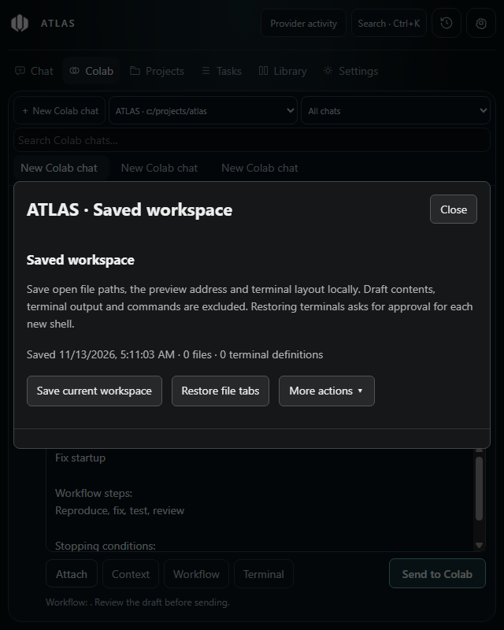
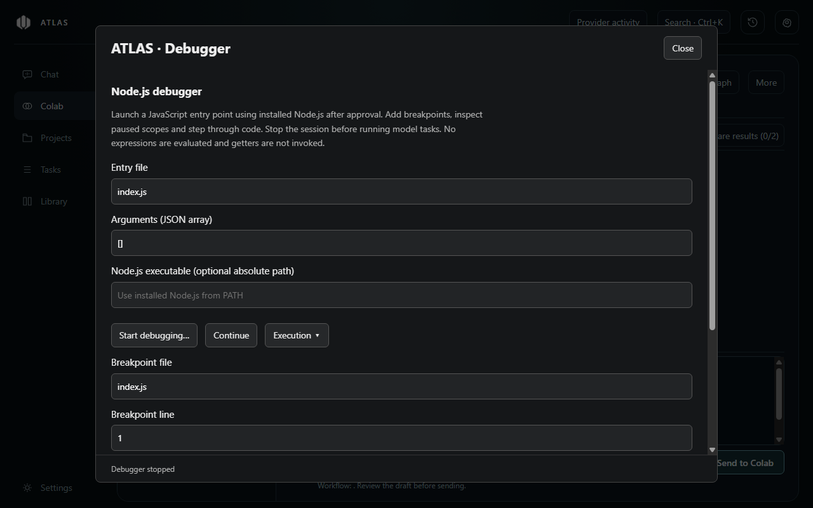

# Deeper project tools (0.11.1)

ATLAS 0.11.1 adds the following local project tools. They add no dependencies and do not start provider sessions when a tool opens.

| Feature | Location | Behaviour |
| --- | --- | --- |
| Guided benchmarks | Tasks → Review → Workflow benchmarks | Add named tasks, acceptance criteria, checks and pinned model configurations using forms. JSON remains an advanced option. Running a batch still requires approval and uses provider allowance. |
| Editor actions | Tasks → Project → Project editor → Code | Quick fixes/refactors and Organise imports use an installed language server. Every affected file must be reviewed before applying. |
| File moves | Project editor → File → Move file… | Review source removal and destination contents; existing destinations are protected. |
| Workspace restoration | Tasks → Project → Saved workspace | Explicitly save/restore file tabs, the active file, preview path and terminal layout. Restoring terminal definitions asks approval for each new shell. |
| Interaction recording | Live preview → Browser checks | Start after approval, interact with the local page, stop and review the draft recipe. Nothing runs automatically. |
| Focused context | Existing project context/index controls | Prefer matching function/class slices and include bounded changed lines from the previous index refresh. |
| Stable visual review | Live preview → Visual review | Capture at consistent viewport, scale and scroll position; optionally ignore reviewed screenshot rectangles. |
| Large histories | Assistant and Colab | Chunked storage, page controls, whole-chat search and visible-message mounting with an offscreen buffer. |
| Node.js debugger | Tasks → Project → Debugger | Start a JavaScript entry point, add breakpoints, continue/pause/step, open stack sources and inspect paused local scopes. |

## Editor boundaries

Completion supports LSP text edits, insert/replace ranges, additional same-file edits and simple numbered snippet defaults/choices. The first placeholder is selected; this is not a full tab-stop snippet editor. Variables, transformations and executable commands are omitted. Completion changes the draft; Save remains separate.

Reviewed workspace actions accept `changes` or `documentChanges`, including text-file create/move/delete operations. They support up to 50 allowed text files, 256 KiB per file and 8 MiB of before/after text. Directories, binary files, byte-order marks, private paths, links and unknown/stale document versions are rejected. Files changed after review cannot be overwritten. Partial filesystem failures retain undo for files already changed. Undo lasts one hour in the current process; it is not crash recovery. Moving a file does not automatically rewrite imports unless the server explicitly proposes those edits.

The adapter follows the [LSP workspace-edit format](https://github.com/microsoft/language-server-protocol/blob/gh-pages/_specifications/lsp/3.17/types/workspaceEdit.md). Server support varies. Only a fixture language server was used for validation; none was installed.

## Local state and recording

Workspace snapshots are bounded to 50 projects in local browser storage. They contain file paths, preview origin/path, terminal type/count/width and timestamps. They exclude drafts, terminal output, command history, query strings and URL fragments. Missing or denied files are reported individually. Existing unsaved editor tabs are retained. A saved preview does not start its development server.

The sandboxed recorder captures trusted button/link clicks and changed text/search/number/URL fields, textareas and selects. It captures up to 30 steps, coalesces consecutive fills of one field and ignores password/hidden/file fields, marked private regions and likely personal/credential fields. These checks are heuristic: use test data and review every captured selector/value. Iframes and contenteditable controls are not recorded. No page receives the ATLAS API. Captured steps stay in memory until explicitly saved as an existing local plaintext recipe; rerunning still needs approval.

## Context and visual evidence

Context selection splits common identifier words and uses bounded lexical function/class boundaries. It is not embedding search or a complete parser. Recent-change hints compare two in-memory index revisions; they are not a Git diff or a complete change history. Existing exclusions and context budgets still apply. The context preview reports selected character counts and reasons. No token-saving percentage or quality improvement is claimed without provider benchmarks.

Source excerpts and relationship hints are JSON-quoted as untrusted reference data. This framing does not guarantee resistance to prompt injection; provider tool permissions still determine access.

Visual captures wait for fonts with a timeout, reset Web Animations to time zero for capture, pause CSS animation/transition effects and hide the caret. Animation states and temporary styles are restored afterwards. Canvas/video content, timers, live data and asynchronous font loading can still differ. Comparisons require matching URL, viewport, pixel scale, scroll position and image size. Up to 20 pixel rectangles can be ignored; masks are saved with named baselines. Overlapping masks count once, and masking the entire screenshot is rejected. Changed-pixel percentages use only unmasked pixels.

## History storage and migration

Assistant migrates `conversations.json` to `chat-index.json` plus content-addressed files in `chat-chunks`. The legacy file is retained. Older ATLAS versions do not understand the new index or Colab database version; use the saved pre-update backup for a downgrade instead of opening the migrated profile in an older version. Chunks contain up to 150 messages, normally around 1 MiB or less; a single message can be up to 16 MiB. Writes publish complete chunks before atomically updating the index. Read integrity checks reject damaged chunks rather than replacing them with empty history. An ordinary chat save no longer rewrites every chat. Metadata listings and paged reads do not load every conversation body. Explicit exports, imports, branches and provider follow-ups can still load a complete selected chat. Search scans disk chunks and returns a bounded page of matching messages.

Colab upgrades IndexedDB in one transaction to metadata plus 150-message chunks. Unchanged chunks are not rewritten by draft saves. Colab still loads its complete message arrays into renderer memory for compatibility with its synchronous task/branch/export flows; this is a remaining memory limit for very large Colab collections.

For chats over 300 messages, both timelines mount visible messages plus a 600-pixel buffer within each 150-message page. Measured placeholders preserve scroll space; focused controls remain mounted. Finding text temporarily mounts the matching page so match navigation remains accessible. No messages are deleted by pagination. Chunk data participates in managed record backups and local-data reset. Unreferenced Assistant chunks and the original migration file are retained for recovery and may consume additional disk space until reset.

## Debugger boundaries

The initial debugger launches `.js`, `.cjs` or `.mjs` entry files using an installed Node.js runtime, with up to 30 arguments. It does not install a runtime, compile TypeScript, attach to existing processes, resolve source maps, debug browsers/Python or evaluate expressions. Native modules must match that runtime. Sessions have a 30-minute limit. Project code runs with the user's account permissions, including filesystem/network access; the native launch approval explains this.

The inspector binds to `127.0.0.1` on a random port. Only ATLAS-owned children are stopped. Active debugging blocks model tasks and conflicting ATLAS writes. The app exposes an allowlist of debugger operations instead of arbitrary inspector commands. Variable inspection is explicit, limited to non-global paused scopes and bounded to 100 properties/2,000 characters per value; getters are not invoked. Debug output and values are not sent to a model automatically. The implementation uses [Node inspector](https://nodejs.org/api/inspector.html) and the [Debugger protocol](https://chromedevtools.github.io/devtools-protocol/tot/Debugger/).
