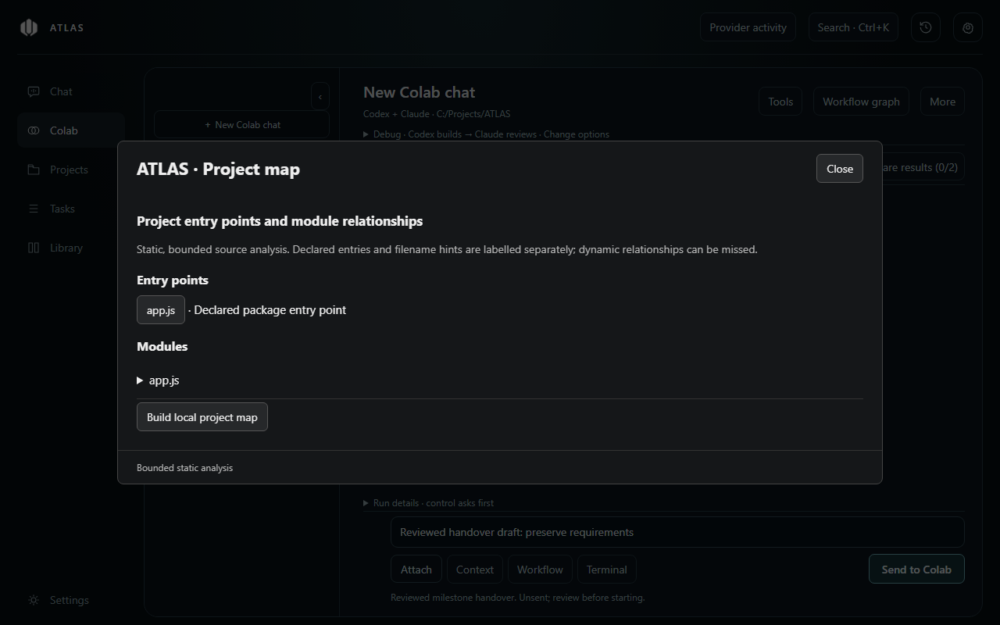

# Work sessions (0.10.1)

These ten additions are included in ATLAS 0.10.1. They are not in the older ATLAS 0.10.0 installer. They add no dependencies, publisher telemetry or automatic provider calls.

1. **Task checkpoints and branching — Tasks → Trial checkpoints.** Capture the selected dedicated project folder, create multiple isolated trials from the same checkpoint and compare their current files. Copies include eligible text and binary files, capped at 1,000 files, 8 MiB per file and 12 MiB total, with a depth limit of 12. An incomplete/oversized scan fails instead of silently claiming a complete snapshot. Private/denied paths, dependencies and common generated folders are excluded. Trial folders have no copied Git history and may need separately approved dependency setup before running. Saved project instructions, model choices and completion checks are copied into a separate trial profile; permission grants and setup commands are not copied. Selecting a trial opens an unsent draft in its folder, preserving the original project. Export a preferred trial into an empty dedicated folder; exports refuse existing files. For a merge back into an existing project, use the existing reviewed diff/Git tools. A maximum of 30 checkpoints and 60 trial records are retained. Forgetting a trial record preserves its files; remove unneeded files deliberately. Generic orphan cleanup protects trial checkpoints.
2. **Project map — Tasks → Project map.** Inspect declared package entry points, separately labelled filename hints, module definitions and resolved local imports. File buttons open guarded local previews. Maps use the existing bounded static index, show up to 300 modules and disclose limited scans. Dynamic imports, aliases and runtime relationships can be missed. No scripts execute to build the map.
3. **Reusable recipes — Library → Workflows.** Saved templates now include ordered steps and stopping conditions, as well as task, mode, acceptance criteria and required check commands. Applying a recipe adds the steps/conditions to an unsent Colab task. Custom stopping conditions are task instructions, not a new formal workflow language. Existing Debug reproduction gates, completion-check gates, permission decisions and pass limits still govern execution. Plan/Compare do not execute workflow checks.
4. **Context freshness — Tasks → Context freshness.** Save a baseline or compare an earlier baseline against current eligible project files. Assistant also captures bounded hashes before requests and warns when project files changed since its preceding recorded context. Changed paths are supplied as reference warnings so the model can inspect current files before relying on earlier conclusions. Receipts contain paths/hashes, not source contents; up to 80 receipts are retained within an 8 MiB aggregate target. The same file/depth/byte scan limits apply; unavailable scans are reported instead of treated as fresh. Imported attachment copies remain immutable: reattach edited originals. A hash comparison does not validate the truth of a prior conclusion. Colab can use the manual freshness panel; its existing stage context/check mechanisms remain in place.
5. **Model handoff — Tasks → Model handoff / Milestone handovers.** Review a milestone packet, choose Codex or Claude in its provider selector and open a fresh Assistant draft. Goals, constraints, changed files and executed-check summaries carry forward; provider session IDs and permissions do not. The selected provider is expressed as an explicit routing request. A current unsent draft or missing/moved source profile blocks replacement. Nothing sends until you send the draft.
6. **Review inbox — Tasks → Review inbox.** Gather failed/abnormal checks, stopped tasks, questions where recorded, completed change reviews, unresolved tracked requirements and pending approvals. Open the source task or approval panel to act. Dismissing a version of evidence does not fix a check, apply changes or grant permission. A changed check result reappears. The list covers retained records and caps at 200 entries; refresh explicitly while work runs.
7. **Acceptance tracking — Tasks → Acceptance evidence.** Add requirements to a retained finished task, record explanatory notes and link an executed check. Claims are labelled unverified. Passing check links are labelled “user-linked evidence,” because a passing test is not proof of every requirement. A changed/rerun result invalidates the old link; use the relink action after inspecting the current check. Remove obsolete requirements individually. Up to 500 requirement records are retained.
8. **Solution search — Library → Task solution search.** Search retained task prompts/results, error output, check commands and saved file/diff evidence, optionally scoped to the current project. Older saved archives can be inspected directly. Review an excerpt before opening it as reference in a fresh unsent draft; it never grants authorization. Searches inspect bounded text from retained tasks and up to 100 archives, returning at most 100 matches. This is local lexical search, not semantic embedding search or access to remote web-chat history.
9. **Offline preparation — Tasks → Offline preparation.** Rank source excerpts, detect suitable commands, and optionally run only selected detected checks after native confirmation. No model, installation or network audit is invoked by passive preparation. Approved project commands can themselves access the network. Select the excerpts that enter the fresh unsent draft. Preparation detects intervening project changes and refuses a stale draft; prepare again when needed. In-memory drafts expire after ten minutes and disappear on restart.
10. **Bug reports — Tasks → Bug report builder.** Supply reproduction steps, expected/actual behavior, app/platform/OS version and optional selected task-check evidence. Raw check output is excluded by default. Preview the heuristically redacted report, edit it and explicitly confirm review before exporting through a save dialog. Changing form inputs invalidates the preview; editing the report clears the review checkbox. No chats, source files or screenshots attach automatically, and nothing uploads. Redaction cannot identify every secret or private sentence; review all contents. Export drafts expire after ten minutes.

## Local data and recovery

`work-sessions.json` stores checkpoint/trial metadata, hash receipts, requirement notes and inbox dismissals. Captured project bytes live in `task-evidence/trial-snapshots`. Trial working files live under ATLAS's managed `worktrees` folder. This data is not encrypted by ATLAS. Managed-record backups include metadata and captured checkpoint records, but do not back up trial working folders. **Export any trial you want to keep into your own project folder before resetting/deleting ATLAS data.** Resetting current ATLAS data removes these local records and managed trial folders. Exported copies remain separate. Individual snapshot removal refuses checkpoints still referenced by trial records; forgetting a record preserves the corresponding files and profile.

Source scans and comparisons are bounded filesystem observations, not atomic snapshots of a running application. Finish concurrent edits before capturing checkpoints. Trial exports do not overwrite files, but a filesystem error during export can leave a partial new copy; the source trial remains intact. No feature certifies correctness, legal compliance or security.
